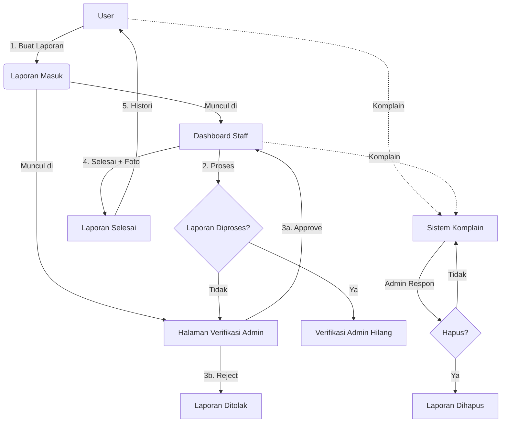

<div align="center">

# 📢 LaporAja

### Sistem Pengaduan Sarana & Prasarana Sekolah

**Platform digital untuk melaporkan kerusakan fasilitas sekolah dengan mudah, cepat, dan transparan.**

[](https://laravel.com)
[](https://php.net)
[](https://mysql.com)
[](https://getbootstrap.com)
[](LICENSE)

[Fitur](#-fitur-utama) •
[Demo](#-demo-akun) •
[Instalasi](#-instalasi) •
[Tech Stack](#️-tech-stack) •
[Struktur](#-struktur-project)

</div>

---

## 📖 Tentang Proyek

**LaporAja** adalah aplikasi web berbasis Laravel yang dirancang untuk mempermudah siswa, guru, dan staff sekolah dalam melaporkan kerusakan sarana & prasarana. Sistem ini menggantikan proses pelaporan manual yang tidak efisien dengan platform digital terintegrasi.

### 🎯 Tujuan
- 🚀 **Mempercepat** proses pelaporan kerusakan fasilitas sekolah
- 📊 **Memudahkan** tracking status perbaikan secara real-time
- 🛡️ **Menjaga** kualitas laporan melalui verifikasi admin
- 📸 **Mendokumentasikan** bukti kerusakan & perbaikan dengan foto

---

## ✨ Fitur Utama

### 👥 Multi-Role System (4 Level Akses)

<table>
<tr>
<td width="25%" align="center">

#### 🧑‍🎓 User
<sub>Siswa / Guru</sub>

- Buat laporan
- Upload foto (kamera/file)
- Tracking status
- Buat komplain
- Lihat histori

</td>
<td width="25%" align="center">

#### 🔧 Staff
<sub>Teknisi Sarpras</sub>

- Lihat semua tugas
- Update status perbaikan
- Upload foto bukti perbaikan
- Komplain ke admin

</td>
<td width="25%" align="center">

#### 🛡️ Admin
<sub>Supervisor</sub>

- Verifikasi laporan
- Moderasi konten
- Respon komplain
- Kelola user
- Supervisi keseluruhan

</td>
<td width="25%" align="center">

#### ⚡ Super Admin
<sub>Owner Sistem</sub>

- Approval akun baru
- Semua akses admin
- **Tidak bisa dihapus**

</td>
</tr>
</table>

### 🎯 Fitur Lengkap

| Fitur | Deskripsi |
|-------|-----------|
| 📝 **Pelaporan Digital** | Form laporan dengan judul, deskripsi, lokasi, & foto bukti |
| 📷 **Kamera Langsung** | Ambil foto langsung dari browser (mobile & desktop) |
| 🔍 **Zoom Foto** | Klik foto untuk melihat detail (medium-zoom) |
| ⏱️ **Timeline Status** | Riwayat perubahan status laporan |
| ✅ **Verifikasi Berlapis** | Admin verifikasi → Staff proses → Selesai |
| 💬 **Sistem Komplain** | User & Staff bisa komplain ke admin |
| 🗑️ **Moderasi Konten** | Admin bisa hapus laporan tidak pantas |
| 📱 **Responsive** | Bottom nav di mobile, sidebar di desktop |
| 🔐 **Role-Based Access** | Middleware multi-role |
| 📊 **Dashboard Statistik** | Card stats & badge notifikasi |

---

## 🖼️ Screenshot

<div align="center">

### 🔐 Halaman Login


### 📊 Dashboard


### 📝 Form Laporan + Kamera


### 📱 Mobile View


</div>

> 💡 **Tips**: Buat folder `docs/` di root project, taruh screenshot di sana dengan nama sesuai di atas.

---

## 🔑 Demo Akun

| Role | Email | Password | Akses |
|------|-------|----------|-------|
| ⚡ **Super Admin** | `super@laporaja.id` | `super123` | Approval akun + semua fitur admin |
| 🛡️ **Admin** | `admin@laporaja.id` | `admin123` | Verifikasi + moderasi + kelola user |
| 🔧 **Staff** | `staff@laporaja.id` | `staff123` | Update status laporan |
| 🧑‍🎓 **User** | `user@laporaja.id` | `user123` | Buat laporan + komplain |

> ⚠️ Ganti password default ini **sebelum deploy** ke production!

---

## 🛠️ Tech Stack

<table>
<tr>
<td align="center" width="25%">
<br>
<b>Laravel 12</b><br>
<sub>Framework PHP</sub>
</td>
<td align="center" width="25%">
<br>
<b>MySQL</b><br>
<sub>Database</sub>
</td>
<td align="center" width="25%">
<br>
<b>Bootstrap 5.3</b><br>
<sub>UI Framework</sub>
</td>
<td align="center" width="25%">
<br>
<b>Vanilla JS</b><br>
<sub>Interactivity</sub>
</td>
</tr>
</table>

### Library & Tools
- 🎨 **Bootstrap Icons** — Icon set modern
- 🔍 **Medium Zoom** — Zoom foto interaktif
- 📷 **MediaDevices API** — Akses kamera browser
- 🎯 **Inter Font** — Typography modern

---

## 📦 Instalasi

### 📋 Prasyarat

Pastikan sudah terinstall:
- ✅ **PHP >= 8.2** → [Download](https://www.php.net/downloads)
- ✅ **Composer** → [Download](https://getcomposer.org)
- ✅ **MySQL** (via XAMPP/Laragon) → [Download XAMPP](https://www.apachefriends.org)
- ✅ **Node.js** (opsional, untuk asset build)
- ✅ **Git** → [Download](https://git-scm.com)

### 🚀 Langkah Instalasi

```bash
# 1. Clone repository
git clone https://github.com/USERNAME/laporaja.git
cd laporaja

# 2. Install dependencies PHP
composer install

# 3. Copy file environment
cp .env.example .env
# Windows:
# copy .env.example .env

# 4. Generate application key
php artisan key:generate

# 5. Setup database
#    Buat database baru di phpMyAdmin:
#    - Nama: laporaja
#    - Collation: utf8mb4_general_ci
#
#    Lalu edit .env:
#    DB_DATABASE=laporaja
#    DB_USERNAME=root
#    DB_PASSWORD=

# 6. Jalankan migrasi + seeder
php artisan migrate:fresh --seed

# 7. Buat symbolic link untuk storage
php artisan storage:link

# 8. Jalankan server
php artisan serve
```

Buka browser: **http://localhost:8000**

---

## 📂 Struktur Project

```
laporaja/
├── app/
│   ├── Http/
│   │   ├── Controllers/
│   │   │   ├── AuthController.php          # Login & register
│   │   │   ├── DashboardController.php     # Dashboard & histori
│   │   │   ├── LaporanController.php       # CRUD laporan
│   │   │   ├── AdminController.php         # Verifikasi & moderasi
│   │   │   ├── StaffController.php         # Update status
│   │   │   ├── SuperAdminController.php    # Approval akun
│   │   │   └── KomplainController.php      # Sistem komplain
│   │   └── Middleware/
│   │       └── RoleMiddleware.php          # Multi-role guard
│   └── Models/
│       ├── User.php
│       ├── Laporan.php
│       ├── StatusLaporan.php
│       └── Komplain.php
├── database/
│   ├── migrations/                         # Struktur database
│   └── seeders/                            # Data dummy
├── resources/
│   └── views/
│       ├── layouts/                        # Master layout
│       ├── auth/                           # Login/register
│       ├── laporan/                        # Buat & detail laporan
│       ├── admin/                          # Halaman admin
│       ├── staff/                          # Halaman staff
│       ├── super/                          # Halaman super admin
│       └── komplain/                       # Sistem komplain
├── routes/
│   └── web.php                             # Semua route
└── public/
    └── storage/                            # Symlink upload
```

---

## 🔄 Alur Sistem



---

## 🧪 Testing

```bash
# Jalankan semua test
php artisan test

# Test spesifik
php artisan test --filter=AuthTest

# Dengan coverage
php artisan test --coverage
```

---

## 📝 Development Notes

### Clear Cache
```bash
php artisan optimize:clear
```

### Refresh Database
```bash
php artisan migrate:fresh --seed
```

### Buat User Admin Baru via Tinker
```bash
php artisan tinker
>>> \App\Models\User::create([
...     'name' => 'New Admin',
...     'email' => 'newadmin@laporaja.id',
...     'password' => bcrypt('password123'),
...     'role' => 'admin',
...     'status_akun' => 'approved',
...     'is_approved' => true,
... ]);
```

---

## 🚀 Deployment

### Opsi 1: Shared Hosting (cPanel)

```bash
# Di server
composer install --no-dev --optimize-autoloader
php artisan config:cache
php artisan route:cache
php artisan view:cache
php artisan storage:link
```

Arahkan document root ke folder `public/`.

### Opsi 2: VPS (Ubuntu + Nginx)

Ikuti panduan Laravel deployment:
- [Laravel Deployment Docs](https://laravel.com/docs/deployment)

### Opsi 3: Platform as a Service

- **Railway** → [railway.app](https://railway.app)
- **Render** → [render.com](https://render.com)
- **Fly.io** → [fly.io](https://fly.io)

---

## 🤝 Kontribusi

Kontribusi sangat diterima! Ikuti langkah berikut:

1. **Fork** repository ini
2. Buat **branch** fitur baru (`git checkout -b fitur/FiturBaru`)
3. **Commit** perubahan (`git commit -m 'Add: Fitur Baru'`)
4. **Push** ke branch (`git push origin fitur/FiturBaru`)
5. Buat **Pull Request**

### Konvensi Commit

```
Add: Fitur baru
Fix: Bug fix
Update: Perbaikan
Docs: Dokumentasi
Style: Formatting
Refactor: Refactoring
```

---

## 🐛 Bug Report

Menemukan bug? Buka [Issues](https://github.com/USERNAME/laporaja/issues) dengan template:

```markdown
**Deskripsi Bug**
[Jelaskan bug-nya]

**Langkah Reproduksi**
1. Login sebagai...
2. Klik...
3. Error muncul

**Expected Behavior**
[Yang seharusnya terjadi]

**Screenshot**
[Kalau ada]

**Environment**
- OS: Windows 11
- Browser: Chrome 120
- PHP: 8.2
```

---

## 📄 License

Project ini dilisensikan under **MIT License** — lihat file [LICENSE](LICENSE) untuk detail.

---

## 👨‍💻 Author

<div align="center">

**Pranaja Abi Praya Widya Tamaka**

<sub>XII RPL C — SMK Negeri 5 Surakarta</sub>

[](https://github.com/USERNAME)

</div>

---

## 🙏 Terima Kasih

- 🎓 **SMK Negeri 5 Surakarta** — Institusi pendidikan
- 👨‍🏫 **Guru Pembimbing** — Bimbingan project
- 💚 **Laravel Community** — Framework luar biasa
- 🎨 **Bootstrap Team** — UI framework

---

<div align="center">

### ⭐ Jangan lupa kasih bintang kalau project ini bermanfaat!

**Made with ❤️ in Surakarta, Indonesia**

</div>
